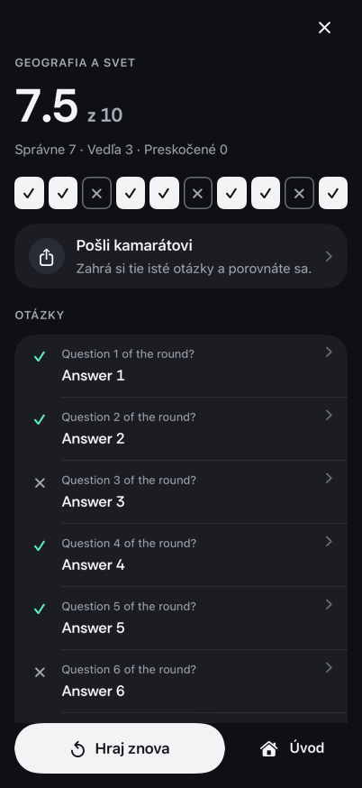
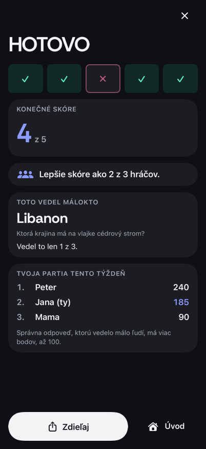
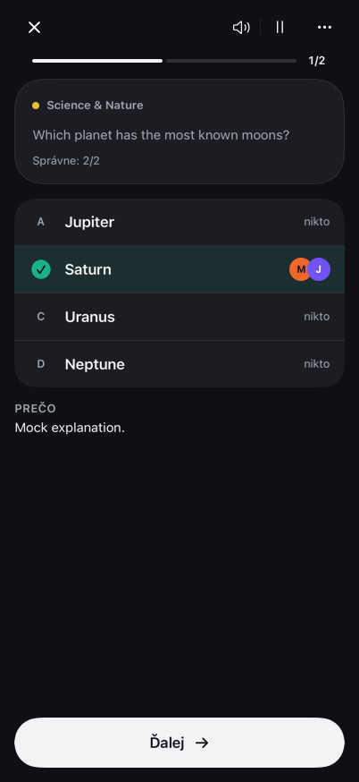
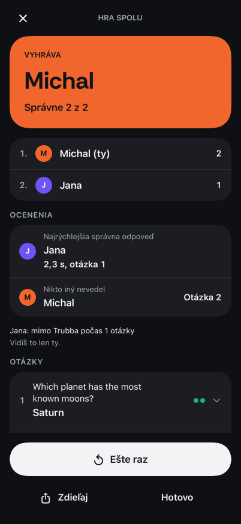
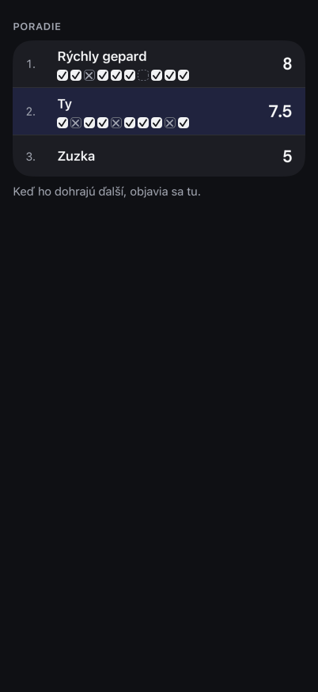

# Trubbo: zábavnosť a chuť zdieľať

**Date:** 2026-11-18 | **Session:** quiz-agent-87 | **Artefakt:** https://claude.ai/artifact/ApjyP33XSGY85ri4DSnC1v

 · úloha #240 — kvalita appky z voľnej kapacity predplatného, časť 240.8

Posudok herného zážitku, nie zoznam chýb. Každý bod je označený: **[údaj]** stojí na číslach z prevádzky alebo na kóde, **[názor]** je môj úsudok opretý o to, čo funguje v iných hrách. V appke sa nič nemení bez tvojho rozhodnutia.

## Štyri veci, ktoré sú dôležitejšie než zvyšok

1. **Noví hráči sa k zábave zatiaľ nedostanú.** **[údaj]** Z 10 kôl, ktoré začali hráči z App Store, nikto nedohral ani jedno. Väčšina hlasových odpovedí skončila ako „nič som nezachytil“.
2. **Najlepšia časť appky je pre App Store hráčov vypnutá.** **[údaj]** Denná výzva s partiou a zdieľanie kvízu odkazom sú len v bete.
3. **Sólo kolo je vecné, ale pomalé a bez odmeny.** **[názor]** Dlhé čakania, žiadne body, žiadna séria, koniec je zoznam.
4. **Hra spolu má dobrý základ a slabý koniec.** **[názor]** Odhalenie odpovedí je dobrá chvíľa, ale je predvolene vypnuté, a hra končí tlačidlom „Hotovo“.

## Prvá minúta nového hráča

**[údaj]** App Store buildy od 2. 11., 9 až 11 inštalácií, 7 hráčov so začatým kolom. Vzorka je malá, berte ako príbehy, nie percentá.

| Čo sa stalo | Číslo |
|---|---|
| Začaté kolá / dohrané | 10 / 0 |
| Kolá bez jedinej odpovede | 5 |
| Hlasové odpovede odmietnuté ako „žiadna reč“ | 17 z 25 |
| To isté u teba a testerov | 27 % |
| Hráči, ktorí sa vrátili v iný deň | 0 z 10 |
| Inštalácie, ktoré kolo ani nezačali | 4 z 11 |

**Prečo appka „nepočuje“** (rozbor 17 odmietnutých odpovedí, len čítaním):

- **Hráč nič nepovedal, kým bol mikrofón otvorený** (najčastejšie). Po otázke appka čaká 10 sekúnd, potom otvorí mikrofón a dá 5 sekúnd na začatie reči. Ticho pošle na server, dostane „žiadna reč“ a skúsi to automaticky ešte raz, takže jedno mlčanie sú dve odmietnutia. Z dát sa nedá rozlíšiť „nevedel odpoveď“ od „nevedel, že má hovoriť“.
- **Mikrofón bol zakázaný a appka to nepovie** (chyba). Hráč hovoril do vypnutého mikrofónu a dostal „nezachytil som“ namiesto „máš vypnutý mikrofón“.
- **Zlyhanie hlasových povelov stiahlo so sebou nahrávanie odpovedí** (chyba, opravená v bete, v App Store builde ešte nie).
- **Jedna inštalácia je pravdepodobne App Review** a skresľuje čísla; bez nej je odmietnutých 11 z 19.

**[názor]** Prvý dojem je dnes „hovorím a ono ma to nepočuje“. Kým sa to nezmení, nič ďalšie v tomto posudku nemá kto oceniť. Čo by som zmenil:

- Zakázaný mikrofón rozpoznať a povedať to jasne, s cestou do Nastavení (čistá oprava).
- Pri prvej otázke ukázať nezameniteľne, že teraz sa hovorí, a mlčanie nepočítať ako neúspešný pokus s výčitkou.
- Zvážiť, či má prvá otázka vôbec čakať 10 sekúnd pred otvorením mikrofónu (tvoje rozhodnutie, mení to rytmus hry).
- Dostať do App Store build s opravou povelov, ktorá je dnes len v bete.

## Sólo kolo

**Čo je dobré** **[názor]**
- Hlas povie verdikt aj správnu odpoveď, pri otázke je krátke „Prečo“. Hráč sa niečo dozvie, to je jadro dobrého kvízu.
- Polovičné body (7,5 z 10) pôsobia férovo.
- Koniec kola má „Hraj znova“ ako hlavné tlačidlo.

**Čo brzdí** **[údaj]** z kódu
- Rytmus jednej otázky: čítanie, 10 s čakanie, 5 s na začatie reči, vyhodnotenie (strop 30 až 35 s), výsledok sa posunie sám po 8 s. Desať otázok je viac čakania než hrania.
- Pri otázke nie sú body ani séria správnych odpovedí, hoci appka najlepšiu sériu počíta a nikde ju neukáže.
- Jediný zvuk je tón mikrofónu.

**Čo by som zmenil** **[názor]**
- Skrátiť mŕtve časy: po výsledku ísť ďalej rýchlejšie, čakanie pred mikrofónom skrátiť alebo nechať hráča začať hovoriť hneď.
- Ukázať sériu („4 za sebou“) a na konci jednu vetu, ktorá stojí za zapamätanie (najťažšia uhádnutá otázka), nie len zoznam.

## Denná výzva a partia

**[názor]** **Toto je najlepšie navrhnutá časť appky** a jediná, ktorá dáva dôvod vrátiť sa zajtra a niekoho pozvať:

- päť otázok je krátke a dá sa dohrať;
- „Lepšie skóre ako 2 z 3 hráčov“ a „Toto vedel málokto“ dávajú pocit, že hráš s ľuďmi;
- partia s bodmi za vzácnosť je presne to, čo podľa tvorcu QuizUp drží hráčov najdlhšie: hráč s kamarátom ostáva výrazne dlhšie;
- zdieľané dlaždice neprezradia odpovede, rovnako ako to fungovalo pri Wordle.

**[údaj]** Vidia ju len beta buildy, v prevádzke nie je jediný záznam. Partia aj odkazy navyše závisia od prepínača zdieľania, ktorý je predvolene vypnutý.

**Čo by som zmenil** **[názor]**
- Dostať dennú výzvu k App Store hráčom ako prvú novú vec. Je krátka, takže znesie aj nedokonalé rozpoznávanie hlasu.
- Čísla na obrazovke sa menia, kým je otvorená, čo mätie. Nechať ich stáť a obnoviť pri ďalšom otvorení.
- Prázdna partia prvý deň: ukázať, čo získaš pozvaním, nie prázdnu tabuľku.

## Hra spolu

 

**Čo je dobré** **[názor]**
- Všetci odpovedajú naraz na vlastnom telefóne, nikto nečaká na ťah. To je vzor, ktorý funguje v Jackboxe aj Kahoote.
- Pripojenie cez QR, odkaz alebo zoznam v okolí, bez prepisovania kódu.
- Odhalenie s krúžkami hráčov pri odpovediach je chvíľa, kde vzniká smiech („ty si dal Neptún?“).

**Čo zábavu oslabuje** **[údaj]** z kódu
- Odhalenie po každej otázke je predvolene vypnuté, odpovede sa ukážu až na konci kola. Najlepšia chvíľa hry sa tak vôbec nestane.
- Na odpoveď je predvolene 30 sekúnd (plán hovoril 10). Kto odpovie hneď, pozerá na „Otázka je uzavretá“.
- Čítanie otázky nemá odpočet, vyhodnocovanie nemá viditeľný stav.
- V miestnosti nie je žiadny zvuk ani vibrácia.
- Koniec: karta víťaza, poradie podľa počtu správnych a tlačidlo „Hotovo“. Žiadna odveta, žiadne zdieľanie, nič vtipné.
- Každý hosť musí mať nainštalovanú appku. Pozvánka do miestnosti sa po inštalácii stratí, kamarát musí dostať odkaz znova.

**Bude to ľudí baviť?** **[názor]** V partii, ktorá má rada kvízy, áno, ak sa odpovede odhaľujú po každej otázke a tempo sa zrýchli. V dnešnom predvolenom nastavení hrozí, že to bude tiché ťukanie do telefónov s výsledkom na konci. Dáta to nepotvrdia ani nevyvrátia: jediná dohraná hra v prevádzke je tvoja z 2. 11.

**Čo by som zmenil, v poradí**
1. Odhalenie po každej otázke ako predvolené.
2. Kratší predvolený čas a kolo uzavrieť hneď, keď odpovedia všetci.
3. Koniec hry: „Ešte raz“ s tými istými ľuďmi a obrázok poradia na poslanie do skupiny.
4. Pár ocenení navyše (najrýchlejší, jediný, kto vedel), aby mal z čoho radosť aj ten, kto nevyhral.
5. Krátky zvuk a vibrácia pri odhalení.

Hlas v skupine je neoverené riziko: nenašiel som žiadnu štúdiu, či je odpovedanie hlasom vo viacerých zábavné alebo rušivé.

## Zdieľanie

**[údaj]** V prevádzke zatiaľ nevznikol ani jeden zdieľaný kvíz a nikto neotvoril odkaz.

| Miesto | Čo sa posiela | Čo vidí príjemca | Stav |
|---|---|---|---|
| Koniec kola | „Zahraj si môj kvíz v Trubbe. Je to N otázok, mám X. Koľko dáš ty?“ + odkaz | s appkou hneď kvíz; bez appky stránka a App Store | len beta |
| Denná výzva | dlaždice, skóre, poradie, odkaz | tých istých 5 otázok | len beta |
| Prehľad hráča | obrázok bez odkazu a textu | nič, na čo sa dá ťuknúť | naživo |
| Koniec hry spolu | nič | nič | chýba |
| Pozvánka do miestnosti | odkaz | bez appky sa pozvánka po inštalácii stratí | za prepínačom |

**Čo je dobré** **[názor]** Výzva „mám X, koľko dáš ty?“ je správne postavená: je osobná, má číslo na prekonanie a kamarát hrá to isté. Poradie s dlaždicami po otázkach dáva dôvod sa k odkazu vrátiť.

**Čo by som zmenil**
- Odkaz v správe nemá náhľad (obrázok a nadpis). V chate vyzerá ako holá adresa. Náhľad s témou a skóre je lacný a zvyšuje šancu na ťuknutie.
- Po inštalácii musí kamarát ťuknúť na odkaz ešte raz. Rešerš hovorí, že bez priameho pokračovania po inštalácii sa väzba na odosielateľa stráca. Dnešné riešenie cez schránku je rozumná náhrada, ale pri pozvánke do miestnosti chýba úplne.
- Obrázok z prehľadu hráča doplniť odkazom.
- Vložená celá správa (text aj odkaz) sa v appke odmietne, funguje len holý odkaz.

Očakávanie: aj pri Wordle zdieľala výsledok menšina (35 % niekedy, 12 % pravidelne). Zdieľanie bude ťahať pár percent hráčov, nie väčšina.

## Čo nedáva zmysel

**[údaj]** Drobnosti, ktoré si hráč všimne ako „prečo to tu je“:

- Vo formulári vlastného balíka je výber veku detí (4–6, 7–9, 10–12) pre každého, hoci rodinná sekcia v appke ešte nie je.
- Keď hráč narazí na mesačný limit uprostred kola, posledný verdikt a koniec kola sa mu neukážu, hoci server ich posiela.
- Čakanie na vlastný balík: po 3 minútach obrazovka „nedá sa skúsiť znova“.
- Starší neprečítaný prehľad hráča sa už nikdy neukáže, keď vznikne novší.
- Zmena „Čo hráme“ v čakárni zneplatní odkaz, ktorý už hostiteľ poslal.
- V kóde sú obrázkové otázky bez vstupu do appky.

## Čo by som spravil, v poradí

| # | Krok | Prečo | Typ |
|---|---|---|---|
| 1 | Opraviť prvú minútu: zakázaný mikrofón, jasné „teraz hovor“, mlčanie bez výčitky | bez toho nikto nedohrá kolo | oprava + tvoje rozhodnutie o rytme |
| 2 | App Store build s opravou povelov z bety | chyba, ktorá vypína nahrávanie | vydanie, na tvoj pokyn |
| 3 | Doplniť meranie: dôvod odchodu z kola, stav mikrofónu, štart a koniec hry spolu, príchod cez odkaz | dnes nevieme, prečo hráči odchádzajú | technické |
| 4 | Denná výzva a partia pre App Store hráčov | jediný dôvod vrátiť sa zajtra | tvoje rozhodnutie |
| 5 | Hra spolu: odhalenie po otázke, kratší čas, koniec s odvetou a zdieľaním | z ťukania spraví hru | tvoje rozhodnutie |
| 6 | Odkazy: náhľad v chate, pozvánka do miestnosti prežije inštaláciu, odkaz na obrázku prehľadu | lacné zvýšenie šance na ťuknutie | technické |
| 7 | Sólo kolo: kratšie čakania, séria, jedna veta na konci | tempo a odmena | tvoje rozhodnutie |

## Ako veľmi tomu veriť

- **Čísla z prevádzky:** 7 až 11 skutočných hráčov. Smer je jasný, veľkosť nie.
- **Príčina odmietnutých odpovedí:** z nahrávok vidno, že mikrofón nič nezachytil. Prečo hráč mlčal, sa z dát nedá povedať.
- **Úsudky o zábave:** podľa rešerše sa model s odborníkmi na použiteľnosť zhodne asi v pätine nálezov. Ber ich ako podnety na vlastné vyskúšanie, nie ako verdikt.
- **Rešerš:** väčšinou rozhovory s tvorcami hier a skúsenosti z praxe, kontrolovaných štúdií je málo.
- **Čo som nevidel:** skutočnú hru spolu s viacerými ľuďmi v miestnosti. Tú nenahradí nič okrem večera s kamarátmi.

Podklady (mapa hráčskeho zážitku, čísla z prevádzky s dopytmi, rozbor odmietnutých odpovedí, rešerš so zdrojmi) vznikli v pracovnom priečinku session quiz-agent-87 (`scratchpad/fun/`), mimo repozitára. Hlavné zdroje rešerše: [Jackbox, zásady návrhu](https://builtin.com/media-gaming/jackbox-games-design-party-pack) · [Wordle, ako sa šíril](https://www.buzzfeednews.com/article/stefficao/how-wordle-went-viral-strategy) · [YouGov, kto zdieľa Wordle](https://yougov.com/en-gb/articles/40799-wordle-starter-words-hard-mode-and-x6-how-are-brit) · [Duolingo, séria dní](https://blog.duolingo.com/improving-the-streak) · [QuizUp, udržanie hráčov](https://www.pocketgamer.biz/interview/74081/teatime-games-ceo-thor-fridriksson-candid-talk/) · [Branch, odkazy po inštalácii](https://www.branch.io/resources/blog/how-mobile-apps-go-viral-user-generated-sharing-links/).
