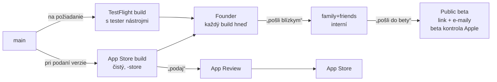

# Tok vydávania: čo sa kam stavia a kto to dostane

Jediný aktuálny prehľad vydávania iOS appky a backendu (founder 2026-10-19). Podrobnosti gitu sú v `.claude/rules/shared.md`, príkazy buildov v `.claude/rules/ios.md`. Staršie `TESTFLIGHT_SETUP.md`, `README_ENVIRONMENTS.md` a `SETUP_ENVIRONMENTS.md` popisujú stav pred touto zmenou; ak si odporujú, platí tento súbor.

## Dva varianty buildu z toho istého kódu

| Variant | Kto ho dostane | Tester nástroje | Ako vzniká |
|---|---|---|---|
| **TestFlight** | Founder, potom na povel blízki a beta | áno (diagnostika hlasu, nahrávky odpovedí, hodnotenie otázok, neschválené otázky, štítky) | `gh workflow run ios-release.yml -f environment=production` |
| **App Store** | App Review a zákazníci (Founder ho vidí v TestFlighte na kontrolu) | nie, vypnuté už pri stavbe | `gh workflow run ios-release.yml --ref main -f environment=production -f store=true` |

Prečo dva: App Review inštaluje appku s rovnakým „sandbox“ dokladom ako TestFlight, takže kontrola za behu ich nerozlíši. Nástroje viditeľné recenzentovi = zamietnutie podľa pravidla 2.2 (#209). Nový tester nástroj sa vždy schová za `BuildChannel.debugSurfacesEnabled()`.

TestFlight buildy len na požiadanie foundera (CLAUDE.md, pravidlo 8). Každý nahraný build dostane git tag `ios/<verzia>-b<build>`, App Store variant navyše `-store`.

## Skupiny testerov (TestFlight)

| Skupina | Typ | Kto | Ktoré buildy |
|---|---|---|---|
| **Founder** | interná | founder | každý build automaticky |
| **family+friends** | interná (ľudia sú používatelia v App Store Connect) | rodina, kamaráti | len na povel „pošli blízkym“, bez čakania na Apple |
| **Public beta** | externá | verejný link (limit 50) + pozvaní e-mailom | len na povel „pošli do bety“; každý build prejde beta kontrolou Apple (zvyčajne hodiny) |
| ~~Alpha~~ | externá | zrušená, e-mailoví testeri patria do Public beta | |

Automatické buildy internej skupiny Apple nastavuje len pri jej založení, neskôr sa nedajú zmeniť (API ani web). Preto family+friends bola 2026-10-19 založená nanovo bez nich; nová interná skupina sa zakladá rovno so správnym nastavením.

Povel foundera = súhlas na zápis do App Store Connect pre ten krok. Príkazy (bez `-f apply=true` len skúšobný beh):

- nastavenie skupín: `gh workflow run asc-store-upload.yml -f steps=groups-setup -f apply=true`
- poslať build N skupine: `gh workflow run asc-store-upload.yml -f steps=promote -f build=N -f group="family+friends" -f apply=true` (alebo `Founder`, `Public beta`)

**Nový tester cez agenta:** skill `/add-tester <e-mail>` (workflow `asc-add-tester.yml`). Blízkemu najprv príde pozvánka do App Store Connect; po jej prijatí agent beh zopakuje a pridá ho do skupiny. Ručný postup nižšie platí, ak API pozvánku odmietne.

**Pridanie blízkeho testera ručne:**
1. App Store Connect → Users and Access → „+“.
2. Meno, e-mail jeho Apple ID, rola **Customer Support**; v časti Apps zvoliť len Trubbo.
3. Po prijatí pozvánky: Apps → Trubbo → TestFlight → Internal Testing → family+friends → Testers „+“ → vybrať ho.
4. Tester si nainštaluje appku TestFlight a prijme pozvánku z e-mailu.

**Pridanie beta testera e-mailom:** TestFlight → External Testing → Public beta → Testers „+“ → Add New Testers → e-mail (bez prístupu do App Store Connect).

## Verzie a podanie do App Store

1. Verzia na `main` (`MARKETING_VERSION`) je tá, ktorá ide najbližšie do obchodu.
2. Podanie: App Store build → `gh workflow run asc-store-upload.yml -f steps=app-review -f build=N -f apply=true` (priradí build, IAP screenshoty, odošle). Prvé nákupy a nová skupina predplatného idú len cez web ASC („Add for Review“).
3. Kým verzia čaká alebo je v review, TestFlight buildy tej istej verzie sa môžu stavať ďalej.
4. Výmena buildu v čakajúcom podaní: najprv stiahnuť podanie z review (ASC → verzia → „Remove from Review“), potom krok 2 s novým buildom. Stratí sa miesto v poradí.
5. Po schválení a vydaní sa verzia v Apple uzavrie: na `main` hneď PR so zvýšením `MARKETING_VERSION` (napr. 1.1 → 1.2), inak ďalší upload zlyhá.
6. Zamietnutie: opraviť na `main`, nový App Store build, odpovedať v Resolution Center a znovu podať.

**Zrýchlené review (expedite)** len pri kritickej chybe živej verzie (pád, nefunkčné nákupy, strata dát) alebo pri termíne udalosti: https://developer.apple.com/contact/app-store/?topic=expedite. Nie pri prvom vydaní ani „lebo to trvá dlho“; zneužitie môže zablokovať ďalšie žiadosti. Okolo Vianoc je review pomalšie, dôležité verzie podať do polovice decembra.

**Oprava živej verzie,** keď `main` už nesie nehotovú prácu: vetva `hotfix/<verzia>` z tagu buildu podľa `shared.md`, App Store variant z nej, oprava aj späť do `main`.

## Git

Trunk-based (`shared.md`): krátke vetvy → PR → nezávislý Claude review → squash merge do `main`. Nehotové funkcie za prepínačmi (`/app-config` alebo build konfigurácia), nie na dlhých vetvách. `release/1.0` je zmrazený archív starého dizajnu.

## Prostredia

| Prostredie | iOS | Backend | Na čo |
|---|---|---|---|
| **Local** | schéma `Hangs-Local`, simulátor | `localhost:8002` / `:8003` | vývoj, testy |
| **Staging** | iOS build sa nerobí | `*-staging.fly.dev` (`docs/setup/staging.md`) | skúška rizikových zmien backendu a migrácií |
| **Prod** | TestFlight aj App Store | `quiz-agent-api.fly.dev`, `quiz-pack-api.fly.dev` | všetci používatelia vrátane testerov |

- Backend sa nasadzuje len z `main` a musí udržať funkčné všetky živé verzie appky (verzia v obchode + TestFlight buildy u testerov): žiadne lámajúce zmeny API.
- Staré buildy sa vypínajú v `/app-config`: `min_version_app_store` pre obchod, `min_version_testflight` pre TestFlight. Kým je verzia v review, `min_version_*` nad ňu nikdy nedvíhať.
- Nákupy z TestFlightu a od App Review sú „sandbox“ a backend v prod ich prijíma; peniaze idú len z App Store nákupov.
- Tester obsah (neschválené otázky, štítky) server posiela len buildom s hlavičkou TestFlight kanála, ktorú App Store variant nikdy neposiela.
